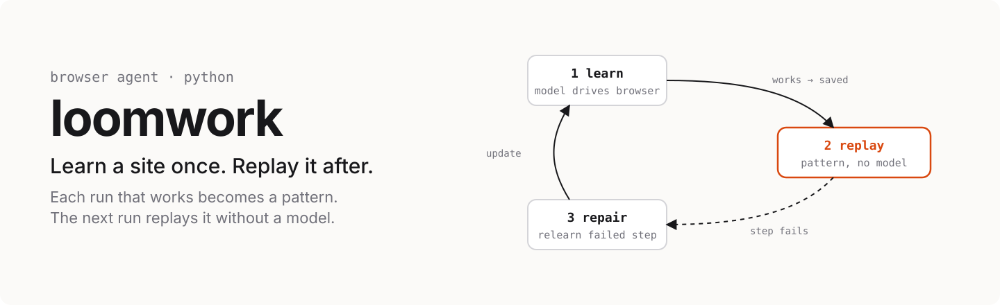

<picture>
  <source media="(prefers-color-scheme: dark)" srcset="./hero-dark.svg">
  
</picture>

<p align="center"><b>The first run asks a model. Every run after replays what worked.</b><br>
loomwork records each browser step as a pattern you can read, diff, and commit.</p>

<p align="center">
  <a href="https://pypi.org/project/loomwork/"></a>
  <a href="https://pypi.org/project/loomwork/"></a>
  <a href="https://github.com/example/loomwork/actions/workflows/ci.yml"></a>
  <a href="./LICENSE"></a>
</p>

<p align="center">
  <a href="#quick-start">Quick start</a> · <a href="#how-it-works">How it works</a> · <a href="#patterns">Patterns</a> · <a href="./docs">Docs</a>
</p>

## Quick start

```bash
pip install loomwork
loomwork run "export last month's invoices from billing.example.com" --save invoices
```

The first run drives a browser with your model and saves `patterns/invoices.yaml`. Run it again:

```bash
loomwork run invoices
```

This time no model is called. loomwork replays the saved steps and checks each page against what it expects.

## How it works

1. **Learn.** A model drives the browser. Each step that works is written down: the page, the element, the action, and what the page should look like after.
2. **Replay.** Later runs follow the pattern directly, which is faster and costs no tokens.
3. **Repair.** When a page no longer matches, only that step goes back to the model. The pattern is updated and the run continues.

## Patterns

A pattern is plain YAML, so it can be reviewed like code:

```yaml
task: export last month's invoices
site: billing.example.com
steps:
  - open: /invoices
    expect: { heading: "Invoices" }
  - click: { role: button, name: "Filter" }
  - select: { label: "Period", option: "Last month" }
  - click: { role: button, name: "Export CSV" }
    expect: { download: "*.csv" }
```

## Requirements

- Python 3.11 or later
- A Chromium browser (installed with `loomwork install-browser`)
- A model provider key for learning and repair runs only

## Documentation

Guides and the full configuration reference are in [docs](./docs).

## License

Apache 2.0. See [LICENSE](./LICENSE).
