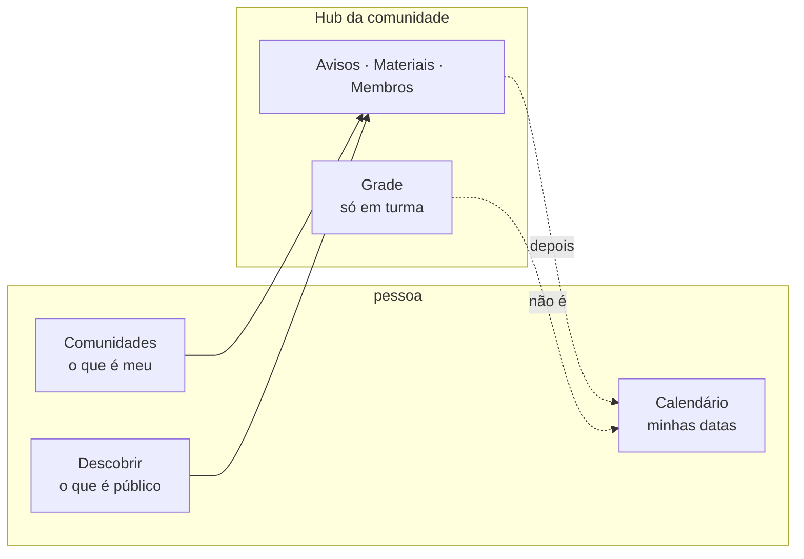
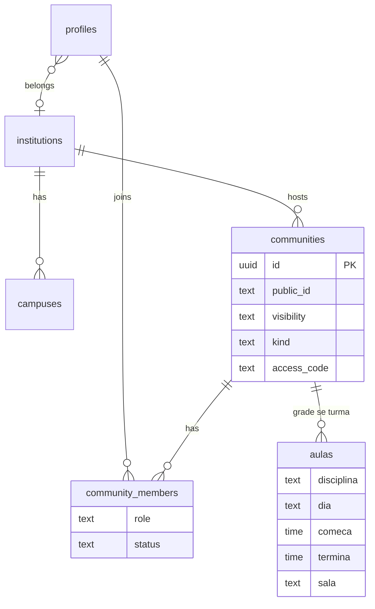

# Orbit

<p align="center">
  
</p>

<p align="center">
  <strong>Sua faculdade, num só lugar.</strong><br />
  Comunidades · grade da turma · Descobrir · calendário pessoal
</p>

<p align="center">
  <a href="#nesta-v1"></a>
  <a href="LICENSE"></a>
  <a href="#stack"></a>
  <a href="#stack"></a>
  <a href="CONTEXT.md"></a>
</p>

---

**Orbit** é o hub open source da **faculdade**: turma, grupo, monitoria e evento num só app. A pessoa cria ou entra numa **comunidade**, o representante monta a **grade** da semana, o **Descobrir** mostra o que é público na instituição, e o **calendário** é a agenda pessoal (na v1, honesta e ainda vazia).

Open source aqui = **app + schema**. Cada clone sobe o **próprio** [Supabase](https://supabase.com). Este repositório **não** traz banco, URL nem chave de ninguém.

Feito por alunos da FATEC; o schema serve **qualquer instituição** de ensino superior no Brasil.

## Nesta v1

| Tem | Ainda não |
| --- | --- |
| Comunidade (turma, grupo, monitoria, evento) com capa, avisos, materiais, membros | Sessão com QR / presença |
| Grade na turma (aula à mão, seg–sáb) | Calendário cheio de datas |
| Entrar por código (privada fora do Descobrir) | Aviso que cai sozinho na agenda |
| Nav: Comunidades · Calendário · Descobrir | Scraping do SIGA |

Glossário: [CONTEXT.md](CONTEXT.md) · Mapa do código: [docs/ARCHITECTURE.md](docs/ARCHITECTURE.md) · Setup do banco: [docs/SUPABASE_SETUP.md](docs/SUPABASE_SETUP.md)

## Como encaixa



- **Comunidades** — lista em que você já é membro (pública ou por código).
- **Descobrir** — vitrine de comunidades **públicas** (`/discover`).
- **Calendário** — agenda pessoal; na v1 só o empty state (sem mentir com CTA errado).
- **Grade** — mora **dentro** da turma, não no calendário.

## Schema (visão rápida)



Migrations na ordem: `001` → `009` em [`supabase/migrations/`](supabase/migrations/). Detalhe: [docs/SUPABASE_SETUP.md](docs/SUPABASE_SETUP.md).

## Stack

- **Next.js 14** (App Router) + TypeScript
- **Supabase** — Auth, Postgres, Storage, RLS
- **Tailwind CSS** + glass (glasscn) onde o fundo importa
- **Vitest** nos módulos de domínio (`grade`, `access`, `join`, …)

## Rotas

| Path | O que é |
| --- | --- |
| `/communities` | As suas |
| `/communities/[id]` | Hub (usa `public_id` curto, ex. `a43qw5pq`) |
| `/create` | Criar comunidade |
| `/discover` | Descobrir |
| `/calendar` | Calendário pessoal |
| `/auth/login` · `/auth/signup` | Auth |
| `/onboarding` | Instituição / campus |

URLs antigas (`/criar`, `/descobrir`, `/calendario`, `/rooms`, `/auth/cadastro`) redirecionam.

## Subir na sua máquina

```bash
git clone https://github.com/MAUXII/presence-track.git
cd presence-track
cp .env.example .env.local
npm install
```

1. Crie um projeto **seu** no [Supabase](https://supabase.com).
2. Cole URL e anon key no `.env.local` (veja `.env.example`).
3. No SQL Editor **do seu** projeto, rode `001` … `009` nesta ordem — [passo a passo](docs/SUPABASE_SETUP.md).
4. `npm run dev` → [http://localhost:3000](http://localhost:3000)

```bash
npm run dev
npm run build
npm run lint
npx tsc --noEmit
npm test
```

Não commite `.env.local`. As chaves são da **sua** instância.

## Contribuir

Leia [CONTRIBUTING.md](CONTRIBUTING.md) antes do PR.

Resumo: interface em **pt-BR**, código/rotas/commits em **inglês**, PR pequeno, testes e typecheck verdes, sem scraping do SIGA e sem segredo no git.

## Licença

[MIT](LICENSE).
