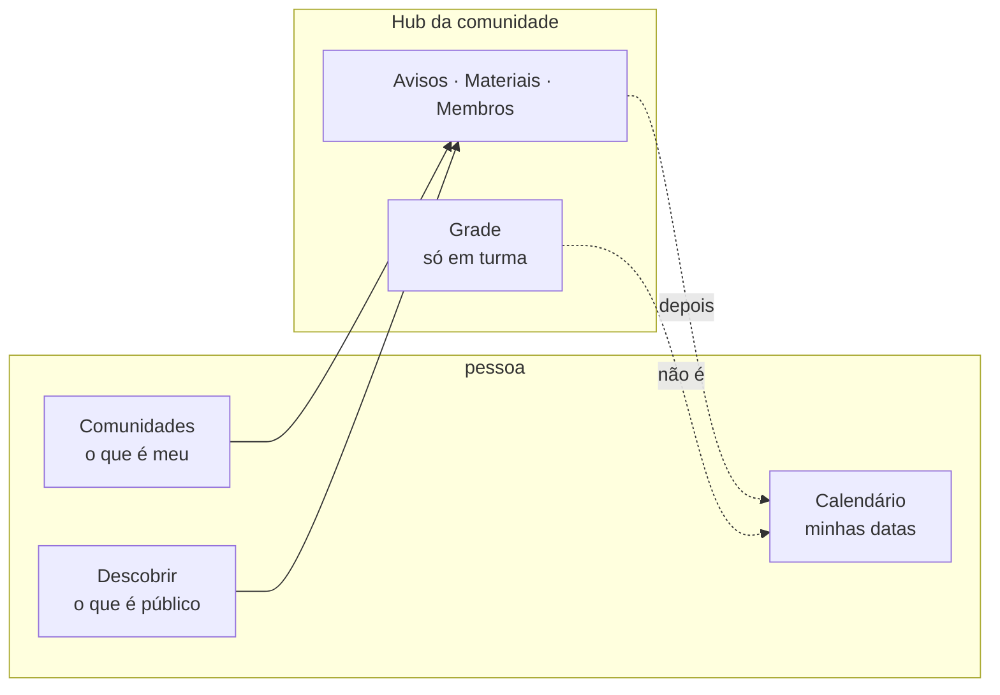
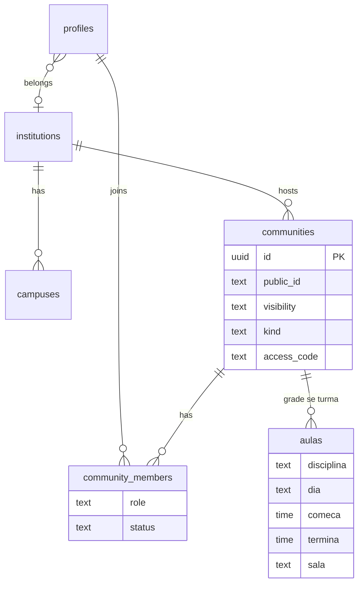

<p align="center">
  
</p>

<p align="center">
  <strong>Sua faculdade, num só lugar.</strong><br />
  Comunidades, grade da turma e calendário pessoal para a vida no campus.
</p>

<p align="center">
  <a href="LICENSE"></a>
  <a href="package.json"></a>
</p>

<p align="center">
  <a href="#subir-na-sua-máquina">Rodar localmente</a> ·
  <a href="#nesta-v1">O que tem no app</a> ·
  <a href="docs/ARCHITECTURE.md">Arquitetura</a> ·
  <a href="CONTRIBUTING.md">Contribuir</a>
</p>

---

**Facultas** reúne a rotina acadêmica em comunidades. Turmas, grupos de estudo,
monitorias e eventos têm um espaço para avisos, materiais e membros. O representante
organiza a grade da turma, e cada pessoa acompanha suas datas no calendário pessoal.

Feito por alunos da FATEC, para estudantes de qualquer instituição de ensino superior
no Brasil. O projeto é open source e inclui o app e o schema do banco. Você pode
hospedar sua instância com um projeto próprio no [Supabase](https://supabase.com).

## Subir na sua máquina

Você precisa de **Node.js 24.x**, npm e um projeto próprio no Supabase.

```bash
git clone https://github.com/MAUXII/facultas.git
cd facultas
cp .env.example .env.local
npm install
```

No PowerShell, copie a configuração com `Copy-Item .env.example .env.local`.

1. Crie um projeto **seu** no [Supabase](https://supabase.com).
2. Cole URL e anon key no `.env.local` (veja `.env.example`).
3. No SQL Editor **do seu** projeto, rode `001` … `024` nesta ordem — [passo a passo](docs/SUPABASE_SETUP.md).
4. `npm run dev` → [http://localhost:3000](http://localhost:3000)

```bash
npm run dev
npm run build
npm run lint
npx tsc --noEmit
npm test
```

Mantenha `.env.local` fora do Git e use a anon key pública na configuração do app.

O guia do banco cobre a configuração inicial até a migration `016`. Complete também
as migrations `017` a `024` disponíveis no repositório.

## Nesta v1

| Recurso | O que você pode fazer |
| --- | --- |
| Comunidades | Reunir turma, grupo, monitoria ou evento com capa e membros |
| Avisos e materiais | Centralizar recados e conteúdo no hub da comunidade |
| Grade da turma | Cadastrar aulas de segunda a sábado com horário e sala |
| Descobrir | Encontrar comunidades públicas da instituição |
| Convites | Entrar por código ou acessar por link, conforme a configuração |
| Calendário pessoal | Organizar compromissos, avisos com data e sessões com presença |
| Assinatura de calendário | Acompanhar as datas em um calendário externo pelo feed ICS |

Glossário: [CONTEXT.md](CONTEXT.md) · Mapa do código: [docs/ARCHITECTURE.md](docs/ARCHITECTURE.md) · Setup do banco: [docs/SUPABASE_SETUP.md](docs/SUPABASE_SETUP.md)

<details>
<summary>Ver o fluxo entre as áreas</summary>



- **Comunidades** — lista em que você já é membro (pública ou por código).
- **Descobrir** — vitrine de comunidades **públicas** (`/discover`).
- **Calendário** — agenda pessoal: o que a pessoa cria e o aviso com data que a comunidade mandou.
- **Grade** — mora **dentro** da turma, não no calendário.

</details>

<details>
<summary>Ver o schema em resumo</summary>



Migrations na ordem: `001` → `024` em [`supabase/migrations/`](supabase/migrations/). Detalhe: [docs/SUPABASE_SETUP.md](docs/SUPABASE_SETUP.md).

</details>

## Stack

- **Next.js 14** (App Router) + TypeScript
- **Supabase** — Auth, Postgres, Storage, RLS
- **Tailwind CSS** + glass (glasscn) onde o fundo importa
- **Vitest** nos módulos de domínio (`grade`, `access`, `join`, …)

<details>
<summary>Ver as rotas</summary>

| Path | O que é |
| --- | --- |
| `/communities` | As suas |
| `/communities/[id]` | Hub (usa `public_id` curto, ex. `a43qw5pq`) |
| `/create` | Criar comunidade |
| `/discover` | Descobrir |
| `/calendar` | Calendário pessoal |
| `/auth/login` · `/auth/signup` | Auth |
| `/auth/avatar` | Escolher avatar |
| `/onboarding` | Instituição / campus |
| `/profile` | Perfil |
| `/privacy` · `/terms` | Privacidade e termos |

As URLs do app seguem o padrão em inglês. Os endereços antigos redirecionam
para as rotas atuais, incluindo `/auth/cadastro` e `/auth/cadastrar` → `/auth/signup`.

</details>

## Contribuir

Leia [CONTRIBUTING.md](CONTRIBUTING.md) antes do PR.

A interface usa **pt-BR**. Código, rotas e commits seguem o padrão em **inglês**.
Envie PRs pequenos e confira testes, lint e typecheck antes de enviar.

## Licença

[MIT](LICENSE).
