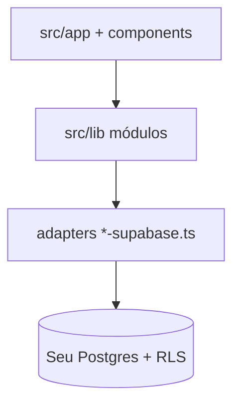

# Onde o código mora

Mapa para quem clona. Não é visão de produto (isso está no [README](../README.md) e no [CONTEXT.md](../CONTEXT.md)).

## Recorte

Orbit é um app que cada pessoa sobe com o **Supabase dela**. O que está neste repo é fonte e schema. RLS no Postgres é a regra de quem lê e quem escreve. Não há um backend nosso além disso.

A v1 que o público encontra: comunidades + grade da turma + **Descobrir** + calendário honesto (ainda vazio de datas). Sessão com QR não entra neste mapa como feature pronta.

## Pastas

| Lugar | O que é |
| --- | --- |
| `src/app/` | Rotas Next.js. Uma pasta, uma URL. |
| `src/lib/routes.ts` | Nomes das rotas. UI não escreve path na mão. |
| `src/lib/community.ts` | Tipos e copy de comunidade (turma, grupo, monitoria, evento). |
| `src/lib/comunidade-service.ts` | Listar, buscar, entrar (adapter de leitura). |
| `src/lib/community-write.ts` | Criar, atualizar e apagar comunidade. |
| `src/lib/community-write-supabase.ts` | Adapter Postgres do write path. |
| `src/lib/community-settings.ts` | Settings. Create e edit chamam a mesma interface. |
| `src/lib/access.ts` | Papel efetivo e o que o ator pode fazer. |
| `src/lib/grade.ts` | Módulo **Grade** (+ `grade.test.ts`). |
| `src/lib/grade-supabase.ts` | Adapter Postgres da grade. |
| `src/lib/hub.ts` | Quem publica aviso e material. |
| `src/lib/hub-supabase.ts` | Adapter Postgres do hub. |
| `src/lib/join.ts` | Entrar pelo código (+ RPC). |
| `src/lib/join-supabase.ts` | Adapter: privada não aparece no Descobrir. |
| `src/components/community-hub/` | Hub da comunidade (abas, grade na UI). |
| `src/components/discover-card/` | Cards do Descobrir. |
| `src/messages/` | Copy pt-BR e en. |
| `src/lib/supabase/` | Cliente browser e servidor. |
| `supabase/migrations/` | Schema e RLS, `001` … `009`. |
| `CONTEXT.md` | Glossário. Sem detalhe de implementação. |
| `docs/adr/` | Decisões duras (v1, calendário + Descobrir). |
| `docs/SUPABASE_SETUP.md` | Como **você** cria a instância **sua**. |
| `docs/assets/` | Imagens do README. |

## Como a Grade foi cortada (exemplo para a próxima feature)

1. Nomes no `CONTEXT.md` (aula, grade, representante).
2. Comportamento no módulo (`createGrade`), testado com port em memória.
3. Postgres no adapter e na migration, com RLS.
4. UI no hub da turma só fala com o módulo.

Não teste JSX para saber se overlap avisa. Teste `src/lib/grade.ts`.

## O que não procurar neste repo

- Banco ou chave de produção
- Scraping do SIGA
- Um servidor de presença separado. Quando sessão existir, ela entra no schema e no calendário da pessoa, não como “criar comunidade”.
